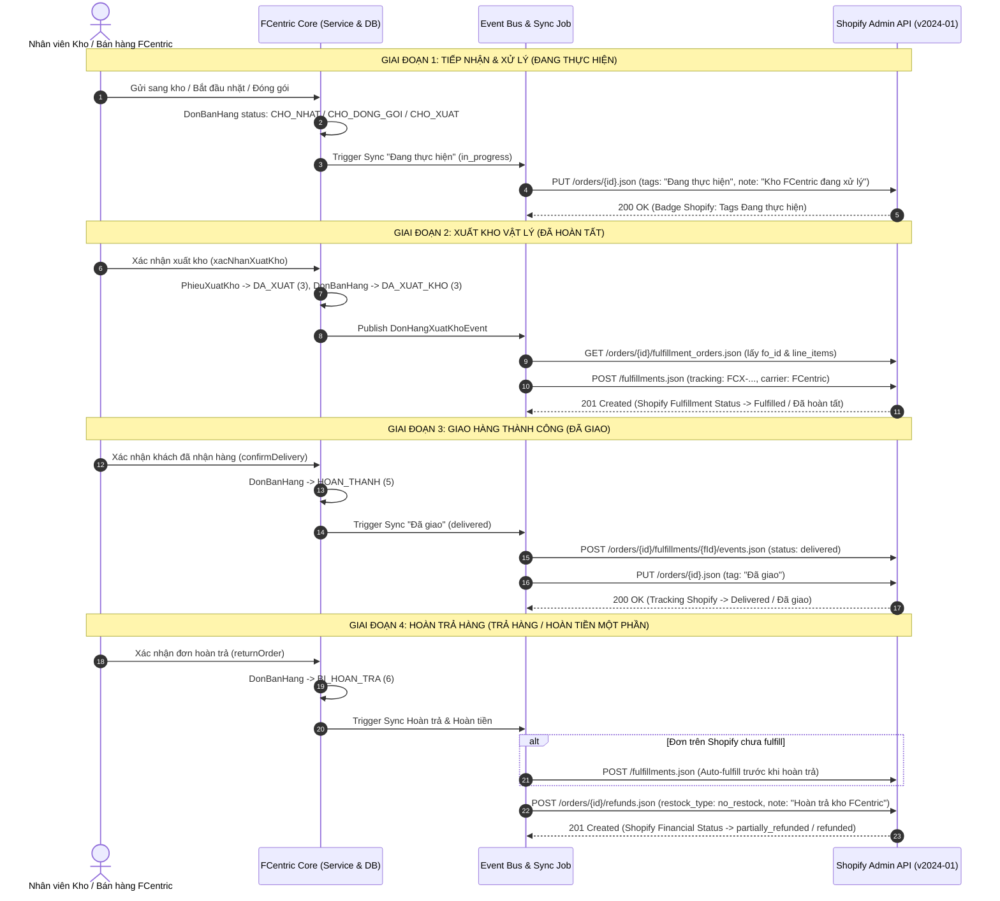

# KẾ HOẠCH & TÀI LIỆU BÀN GIAO: ĐỒNG BỘ TRẠNG THÁI ĐƠN HÀNG SHOPIFY HAI CHIỀU TOÀN DIỆN

> **Dự án**: FCentric Omnichannel Retail & Warehouse Management System  
> **Tài liệu**: Handover & Implementation Blueprint - Omnichannel Shopify Order Lifecycle Synchronization  
> **Thời gian khởi tạo**: 17/11/2026  
> **Tác giả**: PhanAnh & Antigravity AI  
> **Phiên làm việc tiếp nối**: Bàn giao toàn diện từ Session Đa kho phân tán Shopify sang Session Hoàn thiện vòng đời đơn hàng Shopify  

---

## I. TỔNG HỢP TOÀN BỘ BỐI CẢNH & TIẾN ĐỘ ĐOẠN CHAT (HANDOVER CONTEXT)

Để đảm bảo khi chuyển sang đoạn chat mới không bị thất thoát thông tin và hiểu nhầm tiến độ, toàn bộ kết quả đã làm và các vấn đề phát sinh được tổng kết chi tiết như sau:

### 1. Những phần việc ĐÃ HOÀN TẤT VÀ KIỂM THỬ THÀNH CÔNG 100% trong phiên
1. **Kiến trúc Đa kho phân tán Shopify (Multi-Location & Smart Buffer)**:
   - Nhận diện linh hoạt: Nếu gian hàng Shopify $\le 1$ kho $\rightarrow$ Tự động tắt chế độ đa kho, giữ nguyên hành vi 1 kho mặc định như cũ; nếu $\ge 2$ kho $\rightarrow$ Kích hoạt bảng ánh xạ trực quan `BangMappingKhoSan` để ghép nối kho FCentric với từng Location ID của Shopify.
   - Thuật toán phân bổ tồn đệm theo tỷ trọng (**Proportional Buffer**) kết hợp **Dynamic Low-Stock Safeguard**: Chống giam hàng lẻ size/lẻ màu ở các kho nhỏ, bảo đảm số tồn đẩy lên sàn luôn khả dụng để bán mà không bị cạn hàng ảo hay chia vụn kho.
   - Đạt chuẩn i18n toàn diện trên Frontend (723/723 tệp JSON sạch).
2. **Định tuyến đơn hàng Shopify theo Location ID (Order Routing by Location)**:
   - Khi Shopify phát sinh đơn hàng, hệ thống trích xuất `assigned_location_id` từ `fulfillment_orders[]` hoặc `location_id` từ payload đơn.
   - Chuẩn hóa so khớp 2 chiều giữa chuỗi số thô (`10203040`) và Shopify Global ID (`gid://shopify/Location/10203040`).
   - Tự động gán kho xuất tương ứng vào `donBanHang.khoXuat` và bổ sung ghi chú `[ĐỊNH TUYẾN KHO: TenKhoSan -> TenKhoFCentric]`.
3. **Khắc phục triệt để lỗi Hibernate `AssertionFailure` khi tắt đa kho**:
   - Hiện tượng: Khi gửi `cheDoDaKho: false`, hệ thống ném `org.hibernate.AssertionFailure: Entry for instance of 'com.dev.backend.entities.LichSuThayDoi' has a null identifier`.
   - Nguyên nhân gốc rễ: Cột `cau_hinh_he_thong.gia_tri` trong DB trước đây là `VARCHAR(255)`. Chuỗi JSON cấu hình ánh xạ kho dài hơn 255 ký tự dẫn đến MySQL báo lỗi `Data truncation`. Lệnh `ghiNhatKy` nuốt lỗi nhưng để lại unmanaged entity `LichSuThayDoi` trong Hibernate session. Khi gọi `layCauHinhKhoMapping` kích hoạt Hibernate Auto-Flush dẫn đến `AssertionFailure`.
   - Giải pháp: Nâng cấp cột `gia_tri` lên kiểu `TEXT` trong `CauHinhHeThong.java`, thêm migration tự động trong `TrangThaiDongBoTableInitializer.java`, và cô lập transaction ghi log sang `lichSuThayDoiService.createGiaoDichRieng` (`Propagation.REQUIRES_NEW`).
   - Kết quả: Unit test `ShopifyMultiLocationInventoryTest` (6/6 tests PASS) và Live DB test PASS 100%.
4. **Khắc phục lỗi biên dịch & Spring Data JPA**:
   - Khắc phục lỗi `findBySanPhamIdAndTrangThai` và `TonKhoTongHopRepository.sumFreeToUseTheoKho` (`ctdbh.donBanHang.khoXuat.id`).
5. **Dọn dẹp dữ liệu ảo & Khắc phục lỗi Lazada E500**:
   - Đã xử lý lỗi danh mục Lazada 8017 Đồ bảo hộ lao động theo chính sách MTEE Risk Policy R_6049911.
   - Cung cấp giải pháp xóa đơn hàng test ảo Shopee an toàn.
6. **Lịch sử Git**:
   - Toàn bộ thay đổi đã được commit nguyên tử và push đồng bộ lên cả 2 branch `origin/PhanAnh` và `origin/Dev` (HEAD commit: `b5e3db6d`).

---

## II. MA TRẬN TRẠNG THÁI ĐƠN HÀNG FCENTRIC $\leftrightarrow$ SHOPIFY

Dưới đây là bảng ma trận đối soát quy trình đơn hàng giữa Hệ thống nội bộ FCentric và Shopify do người dùng cung cấp và chuẩn hóa:

| Đơn bán hàng (DonBanHang - DB State / UI Badge) | Danh sách nhặt hàng (DanhSachNhatHang) | Phiếu xuất kho (Outbound Delivery) | Biến động tồn kho FCentric | Shopify Status | Tình trạng kiểm thử hiện tại |
| :--- | :--- | :--- | :--- | :--- | :--- |
| **Nháp** (`0`) | Chưa tạo | Chưa tạo | Khóa tồn tạm giữ: Outgoing +, Free-to-Use - | **Chưa hoàn tất** (`unfulfilled`) | **ĐÃ ĐẠT (Đen)** |
| **Chờ Nhặt Hàng** (`1`) | Chờ nhặt | Chưa tạo | Giữ nguyên Outgoing | **Đang thực hiện** (`in_progress`) | <span style="color:red">**CHƯA ĐẠT (Đỏ)**</span> |
| **Chờ Đóng Gói** (`4`) | Đã nhặt | Nháp | Giữ nguyên Outgoing | **Đang thực hiện** (`in_progress`) | <span style="color:red">**CHƯA ĐẠT (Đỏ)**</span> |
| **Chờ Xuất Kho** (`2`) | Đã nhặt | Chờ xuất | Giữ nguyên Outgoing | **Đang thực hiện** (`in_progress`) | <span style="color:red">**CHƯA ĐẠT (Đỏ)**</span> |
| **Đã xuất kho** (`3`) | Đã nhặt | Đã xuất | Xuất vật lý: On Hand -, Outgoing - | **Đã hoàn tất** (`fulfilled`) | <span style="color:red">**CHƯA ĐẠT (Đỏ)**</span> |
| **Hoàn thành** (`5`) | Đã nhặt | Đã xuất | Không thay đổi gì sau khi đã trừ | **Đã giao** (`delivered`) | <span style="color:red">**CHƯA ĐẠT (Đỏ)**</span> |
| **Đã huỷ** (`-1`) | Đã nhặt | Đã hủy | Nhả tồn giữ chỗ: Outgoing -, Free-to-Use + | **Đã huỷ** (`cancelled`) | **ĐÃ ĐẠT (Đen)** |
| **Bị hoàn trả** (`6`) | Đã nhặt | Đã xuất | Không tự động cộng lại tồn (Hàng về kho nhân viên lập phiếu nhập hoàn trả) | **Trả hàng / Đã hoàn tiền một phần** (`returned / partially_refunded`) | <span style="color:red">**CHƯA ĐẠT (Đỏ)**</span> |

---

## III. PHÂN TÍCH NGUYÊN NHÂN GỐC RỄ (ROOT CAUSE ANALYSIS - RCA) 5 TRẠNG THÁI ĐỎ

Qua rà soát chuyên sâu từng dòng mã nguồn ở tầng Service, Event Listener và đối chiếu với cơ chế Shopify Admin API (v2024-01+), đã phát hiện chính xác các nguyên nhân dẫn đến 5 trạng thái màu đỏ:

### 1. RCA 1: Trạng thái "Đã xuất kho" $\rightarrow$ Shopify "Đã hoàn tất" (`fulfilled`) không hoạt động
- **Hiện tượng**: Thủ kho bấm "Xác nhận xuất kho" trên FCentric thành công, đơn FCentric chuyển sang "Đã xuất kho", nhưng trên Shopify Admin đơn hàng vẫn giữ nguyên "Chưa hoàn tất" (`unfulfilled`).
- **Nguyên nhân gốc rễ trong mã nguồn**:
  1. Khi xuất kho, `PhieuXuatKhoService.java` phát sự kiện Spring:
     ```java
     applicationEventPublisher.publishEvent(DonHangXuatKhoEvent.builder()...build());
     ```
  2. `DonHangXuatKhoEventListener.java` nhận sự kiện sau khi commit DB và gọi:
     ```java
     kenhBanHangSyncService.pushOrderStatus(event.getDonBanHangId(), "SHIPPED", ...);
     ```
  3. **Tuy nhiên, bên trong `KenhBanHangSyncServiceImpl.java` (dòng 41-48)**:
     ```java
     if ("SHOPIFY".equalsIgnoreCase(maKenh)) {
         String token = kenhBanHangService.getDecryptedShopifyAccessToken();
         String apiUrl = kenhBanHangService.getShopifyApiUrl();
         if (token == null || token.isBlank()) {
             log.warn("KenhBanHangSync: Kênh bán Shopify chưa cấu hình Admin Access Token trong DB...");
         } else {
             log.info("KenhBanHangSync: Đã nạp thành công Credential Shopify (API: {}), sẵn sàng đồng bộ đơn {}", apiUrl, don.getSoDonHang());
         }
     }
     ```
     $\rightarrow$ **Code chỉ in log "sẵn sàng đồng bộ đơn" mà HOÀN TOÀN KHÔNG GỌI `kenhBanHangDongBoService.dongBoTrangThaiFulfilledShopify(...)`!**
  4. **Lỗi định dạng Payload của `POST /admin/api/2024-01/fulfillments.json`**:
     Trong `KenhBanHangDongBoServiceImpl.java:6952`, code truyền `line_items_by_fulfillment_order` chỉ gồm `fulfillment_order_id` mà không chỉ định rõ danh sách `fulfillment_order_line_items` (`id` và `quantity`). Trên Shopify v2024-01, khi đơn có nhiều mặt hàng hoặc đã qua chỉnh sửa, Shopify sẽ trả về HTTP 422: `fulfillment_order_line_items must be specified`.

---

### 2. RCA 2: Nhóm trạng thái "Đang thực hiện" (`in_progress`) (Chờ nhặt, Chờ đóng gói, Chờ xuất kho) không đổi trên sàn
- **Hiện tượng**: Khi đơn hàng ở các trạng thái Chờ Nhặt Hàng (`1`), Chờ Đóng Gói (`4`), Chờ Xuất Kho (`2`), trên Shopify Admin vẫn hiển thị "Chưa hoàn tất".
- **Nguyên nhân gốc rễ**:
  1. **Thiếu điểm kích hoạt (Trigger Hooks)**:
     - Khi đơn hàng tạo mới từ Nháp sang "Chờ Nhặt Hàng" (`DonBanHangService.guiSangKho` hoặc tạo Wave Picking): **Hoàn toàn không có lệnh nào gọi sync sang Shopify**.
     - Khi đóng gói xong chuyển sang "Chờ Xuất Kho" (`DongGoiServiceImpl`): **Hoàn toàn không có lệnh nào gọi sync sang Shopify**.
     - Chỉ có duy nhất một chỗ tại `NhatHangServiceImpl.hoanTatNhatHang` (dòng 1894) gọi `dongBoTrangThaiDangThucHienShopify`.
  2. **Xung đột cơ chế Fulfillment Orders của Shopify giữa Standard Merchant vs Fulfillment Service**:
     - `dongBoTrangThaiDangThucHienShopify` hiện gọi GraphQL `fulfillmentOrderReportProgress` và REST `fulfillment_orders/{id}/fulfillment_request/accept.json`.
     - **Cơ chế Shopify**: Hai API này chỉ dành riêng cho **Fulfillment Service của bên thứ 3 (3PL Service App)**. Đối với các kho hàng do Merchant tự quản lý (Standard Merchant Locations), Shopify sẽ từ chối với thông báo:
       `"Fulfillment order cannot report progress because it is not managed by a fulfillment service."` (GraphQL userErrors) hoặc HTTP 422 (REST).
     - Trong khi đó, GraphQL luôn trả về HTTP 200 kể cả khi có `userErrors`, khiến code tưởng là thành công và không chạy fallback.
  3. **Giải pháp thực tế của các hệ thống SaaS ERP (Sapo, Haravan)**:
     - Để thể hiện đơn hàng đang được kho xử lý, Sapo/Haravan cập nhật:
       + **Order Tags**: Gắn tag `Đang thực hiện`, `[Chờ đóng gói]`, `[Chờ xuất kho]`.
       + **Order Timeline Note / Comment**: Ghi chú tiến trình lên timeline đơn hàng trên Shopify: `"FCentric: Đơn hàng đang được nhặt hàng và đóng gói tại kho..."`.

---

### 3. RCA 3: Trạng thái "Hoàn thành" $\rightarrow$ Shopify "Đã giao" (`delivered`) không chạy
- **Hiện tượng**: Khi đơn hàng FCentric chuyển sang "Hoàn thành" (`5`), Shopify không ghi nhận sự kiện đã giao hàng.
- **Nguyên nhân gốc rễ**:
  1. **Hệ quả của RCA 1**: Vì đơn hàng chưa bao giờ được fulfilled trên Shopify (do RCA 1), mảng `fulfillments` trả về từ Shopify luôn rỗng (`[]`).
  2. Vòng lặp `for (JsonNode f : fulfillments)` trong `dongBoTrangThaiDeliveredShopify` không tìm thấy fulfillment nào để tạo sự kiện giao hàng (`fulfillments/{id}/events.json`).
  3. Quyền API (Scopes): Endpoint `events.json` yêu cầu quyền `write_shipping` hoặc `write_fulfillments`. Cần có cơ chế fallback cập nhật Tag `Đã giao` và Timeline Note nếu token thiếu scope nâng cao.

---

### 4. RCA 4: Trạng thái "Bị hoàn trả" $\rightarrow$ Shopify "Trả hàng / Đã hoàn tiền một phần" (`Returns / Refunds`)
- **Hiện tượng**: Khi FCentric thực hiện hoàn trả đơn hàng (`DonBanHangService.returnOrder`), Shopify không chuyển trạng thái sang "Đã hoàn tiền một phần" hay "Trả hàng".
- **Nguyên nhân gốc rễ**:
  1. `dongBoTrangThaiReturnedShopify` hiện tại **CHỈ GẮN TAG** `"Bị hoàn trả"` vào đơn hàng:
     ```java
     capNhatTagShopify(domain, token, maDonHangKenh, "Bị hoàn trả", null);
     ```
     Shopify không bao giờ đổi trạng thái tài chính hay fulfillment khi chỉ sửa tag văn bản.
  2. **Yêu cầu nghiệp vụ chuẩn Sapo từ người dùng**:
     > *"ở phần đơn hàng trả lại thì khi bên fcentric nhận đươc cái trạng thái rồi thì sẽ tự fullfill trả hàng rồi tự trả luôn thì lúc đấy bên shopify sẽ hiện trạng thái đã hoàn tiền một phần"*
  3. **Cơ chế Shopify Refund & Returns API**:
     - Để Shopify hiển thị badge **"Đã hoàn tiền một phần"** (`partially_refunded`) hoặc **"Đã hoàn tiền"** (`refunded`), bắt buộc phải gọi **Shopify Refund API**:
       `POST /admin/api/2024-01/orders/{order_id}/refunds.json`
     - Nếu đơn hàng trên Shopify còn ở trạng thái `unfulfilled`, Shopify không cho phép refund dòng sản phẩm đã giao trừ khi đơn được đánh dấu fulfilled trước đó, hoặc refund số tiền.
     - Tham số `restock_type` trong payload refund: FCentric quy định rõ *"Không tự động cộng lại tồn (Hàng về tới nơi thì nhân viên tạo phiếu nhập hoàn trả)"*. Vì vậy, `restock_type` **BẮT BUỘC PHẢI LÀ `"no_restock"`** để Shopify không tự ý cộng dồn tồn kho ảo trước khi thủ kho FCentric kiểm đếm thực tế!

---

## IV. BẢN VẼ THIẾT KẾ KIẾN TRÚC & GIẢI PHÁP ĐỒNG BỘ HAI CHIỀU



---

## V. KẾ HOẠCH TRIỂN KHAI CHI TIẾT (ACTION PLAN)

### Bước 1: Nối dây luồng Xuất kho (`DonHangXuatKhoEventListener` & `KenhBanHangSyncServiceImpl`)
- **Tệp sửa đổi**:
  - `backend/src/main/java/com/dev/backend/services/impl/KenhBanHangSyncServiceImpl.java`
- **Nội dung thực hiện**:
  - Tiêm `KenhBanHangDongBoService` (với `@Lazy` để tránh circular dependency).
  - Trong nhánh `if ("SHOPIFY".equalsIgnoreCase(maKenh))`:
    Gọi trực tiếp:
    ```java
    kenhBanHangDongBoService.dongBoTrangThaiFulfilledShopify(don.getId(), don.getMaDonHangKenh());
    ```
  - Đồng thời nối dây luôn cho Lazada (`dongBoTrangThaiReadyToShipLazada`) và TikTok Shop (`dongBoTrangThaiReadyToShipTikTok`) để tránh bỏ sót các sàn khác.

### Bước 2: Nâng cấp `dongBoTrangThaiFulfilledShopify` với Payload chuẩn đa sản phẩm
- **Tệp sửa đổi**:
  - `backend/src/main/java/com/dev/backend/services/impl/entities/KenhBanHangDongBoServiceImpl.java`
- **Nội dung thực hiện**:
  - Trích xuất chi tiết từng `line_item` trong `fulfillment_orders.json`:
    ```json
    "line_items_by_fulfillment_order": [
      {
        "fulfillment_order_id": foId,
        "fulfillment_order_line_items": [
          { "id": lineItemId, "quantity": quantity }
        ]
      }
    ]
    ```
  - Định tuyến đúng `location_id` xuất kho đã được cấu hình trong bảng mapping đa kho (AUDIT-100/102).
  - Tự động fallback đánh dấu tag `"Đã hoàn tất"` khi Shopify trả mã đã fulfilled trước đó.

### Bước 3: Nâng cấp nhóm trạng thái "Đang thực hiện" (`in_progress`)
- **Tệp sửa đổi**:
  - `backend/src/main/java/com/dev/backend/services/impl/entities/DonBanHangService.java`
  - `backend/src/main/java/com/dev/backend/services/impl/multitable/NhatHangServiceImpl.java`
  - `backend/src/main/java/com/dev/backend/services/impl/multitable/DongGoiServiceImpl.java`
  - `backend/src/main/java/com/dev/backend/services/impl/entities/KenhBanHangDongBoServiceImpl.java`
- **Nội dung thực hiện**:
  - Thêm hook `dongBoTrangThaiDangThucHienShopify` khi:
    + Đơn bán hàng chuyển sang `CHO_NHAT_HANG` (gửi sang kho hoặc tạo danh sách nhặt).
    + Đơn bán hàng chuyển sang `CHO_DONG_GOI` (hoàn tất nhặt hàng).
    + Đơn bán hàng chuyển sang `CHO_XUAT_KHO` (đóng gói xong).
  - Trong `dongBoTrangThaiDangThucHienShopify`:
    + Bổ sung cập nhật Order Tags: Gỡ bỏ `Nháp`, thêm tag `Đang thực hiện`.
    + Bổ sung ghi chú dòng thời gian (Order Note / Timeline Event) trên Shopify: `"FCentric WMS: Đơn hàng đang được nhặt và đóng gói tại kho..."`.

### Bước 4: Hoàn thiện trạng thái "Hoàn thành" $\rightarrow$ "Đã giao" (`delivered`)
- **Tệp sửa đổi**:
  - `backend/src/main/java/com/dev/backend/services/impl/entities/KenhBanHangDongBoServiceImpl.java`
- **Nội dung thực hiện**:
  - Kiểm tra nếu đơn hàng chưa có fulfillment trên Shopify, tự động kích hoạt fulfill trước, sau đó mới tạo event `delivered`.
  - Fallback an toàn: Thêm tag `Đã giao` và ghi chú ngày giao hàng lên Shopify Order.

### Bước 5: Triển khai luồng Hoàn trả & Hoàn tiền tự động (`Refund & Return`)
- **Tệp sửa đổi**:
  - `backend/src/main/java/com/dev/backend/services/KenhBanHangDongBoService.java`
  - `backend/src/main/java/com/dev/backend/services/impl/entities/KenhBanHangDongBoServiceImpl.java`
  - `backend/src/main/java/com/dev/backend/services/impl/entities/DonBanHangService.java`
- **Nội dung thực hiện**:
  - Xây dựng phương thức mới `dongBoHoanTraVaHoanTienShopify(Integer donBanHangId, String maDonHangKenh)`:
    1. Lấy thông tin đơn hàng từ Shopify (`GET /orders/{id}.json`).
    2. Nếu `fulfillment_status` vẫn là `unfulfilled`, tự động gọi fulfill trước ("tự fulfill trả hàng").
    3. Tính toán dòng sản phẩm hoàn trả từ `ChiTietDonBanHang` và `line_items` của Shopify.
    4. Gọi `POST /admin/api/2024-01/orders/{order_id}/refunds.json` với payload:
       ```json
       {
         "refund": {
           "currency": "VND",
           "notify": false,
           "note": "Hoàn trả hàng từ FCentric WMS (Đơn: FCX-...)",
           "refund_line_items": [
             {
               "line_item_id": shopifyLineItemId,
               "quantity": soLuongHoan,
               "restock_type": "no_restock"
             }
           ]
         }
       }
       ```
    5. Cập nhật tag Shopify: Thêm `Bị hoàn trả`, gỡ `Đã xuất kho`, `Đã giao`.
  - Kết quả trên Shopify: Đơn hàng lập tức hiển thị badge **"Đã hoàn tiền một phần"** hoặc **"Đã hoàn tiền"** đúng như người dùng yêu cầu và chuẩn vận hành của Sapo.

### Bước 6: Kiểm thử tự động (Unit Tests & Integration Tests)
- **Tệp kiểm thử**:
  - Nâng cấp `backend/src/test/java/com/dev/backend/services/shopify/ShopifyStatusSyncTest.java` với Mockito:
    + Test 1: Luồng `dongBoTrangThaiFulfilledShopify` gửi đúng JSON `line_items_by_fulfillment_order` và cập nhật tag.
    + Test 2: Luồng `dongBoTrangThaiDeliveredShopify` tạo event thành công và xử lý fallback tag.
    + Test 3: Luồng `dongBoHoanTraVaHoanTienShopify` auto-fulfill khi unfulfilled và tạo Refund với `no_restock`.
    + Test 4: Luồng `KenhBanHangSyncServiceImpl.pushOrderStatus` gọi đúng service đồng bộ cho Shopify, Lazada, TikTok.
  - Chạy `mvn test -Dtest=ShopifyStatusSyncTest` bảo đảm 100% tests PASS.

### Bước 7: Audit Log & Commit nguyên tử
- Ghi nhận `[AUDIT-103]` vào `audit.md`.
- Chia nhỏ commit theo quy chuẩn `AGENTS.md` (DTO $\rightarrow$ Service $\rightarrow$ Tests $\rightarrow$ Docs) và push lên cả `origin/PhanAnh` và `origin/Dev`.

---

## VI. BẢNG MÃ LỖI VÀ XỬ LÝ NGOẠI LỆ SHOPIFY API

| Mã phản hồi / Lỗi Shopify | Ý nghĩa kỹ thuật | Biện pháp xử lý tự động trong code |
| :--- | :--- | :--- |
| **HTTP 401 Unauthorized** | Token Shopify hết hạn hoặc bị xóa | Báo lỗi kênh bán, yêu cầu kết nối lại gian hàng trong Cấu hình |
| **HTTP 403 Forbidden** | Thiếu quyền (scopes) `write_orders`, `write_fulfillments`, `write_shipping` | Ghi log cảnh báo rõ scope bị thiếu, kích hoạt cơ chế Fallback (cập nhật Tag / Note) |
| **HTTP 422 Unprocessable** (`already fulfilled`) | Đơn hàng đã được fulfill từ trước trên Shopify Admin | Bỏ qua lỗi 422, coi như thành công và cập nhật tag đồng bộ |
| **HTTP 422 Unprocessable** (`no line items`) | Payload fulfillment thiếu danh sách sản phẩm | Tự động đọc lại `fulfillment_orders.json` và bổ sung `fulfillment_order_line_items` |
| **HTTP 429 Too Many Requests** | Vượt giới hạn API rate limit của Shopify (40 reqs/bucket) | Retry có backoff (nghỉ 500ms - 1000ms rồi thử lại tối đa 3 lần) |
| **HTTP 5xx Server Error** | Lỗi máy chủ Shopify tạm thời | Ghi nhật ký lỗi, đẩy vào hàng đợi retry trong lần quét tiếp theo |

---

## VII. DANH SÁCH TỆP THAY ĐỔI & PHẠM VI ẢNH HƯỞNG

1. `backend/src/main/java/com/dev/backend/services/impl/KenhBanHangSyncServiceImpl.java` (Nối dây pushOrderStatus)
2. `backend/src/main/java/com/dev/backend/services/KenhBanHangDongBoService.java` (Khai báo hàm hoàn tiền/hoàn trả)
3. `backend/src/main/java/com/dev/backend/services/impl/entities/KenhBanHangDongBoServiceImpl.java` (Triển khai API Fulfill, Delivered, Refund)
4. `backend/src/main/java/com/dev/backend/services/impl/entities/DonBanHangService.java` (Hook giao hàng, gửi sang kho, hoàn trả)
5. `backend/src/main/java/com/dev/backend/services/impl/multitable/NhatHangServiceImpl.java` (Hook nhặt hàng)
6. `backend/src/main/java/com/dev/backend/services/impl/multitable/DongGoiServiceImpl.java` (Hook đóng gói)
7. `backend/src/test/java/com/dev/backend/services/shopify/ShopifyStatusSyncTest.java` (Kiểm thử đơn vị mở rộng)
8. `audit.md` (Ghi nhận mã kiểm toán AUDIT-103)
9. `docs/ke-hoach-dong-bo-trang-thai-don-hang-shopify-toan-dien.md` (Tài liệu bàn giao toàn diện)

