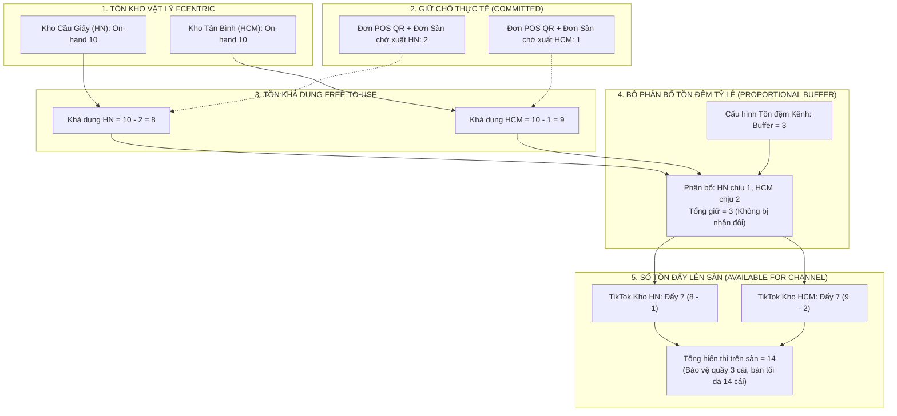

# KẾ HOẠCH TRIỂN KHAI ĐA ĐIỂM KHO VẬN (MULTI-WAREHOUSE OMNICHANNEL) & ÁNH XẠ KHO SÀN (V2.0)

> **Tài liệu đặc tả kỹ thuật & kế hoạch thi công**  
> **Phiên bản:** 2.0.0 (Nâng cấp toàn diện cơ chế ánh xạ liên kết kho & giải quyết triệt để bài toán Tồn đệm thông minh)  
> **Ngày lập:** 17/11/2026  
> **Mục tiêu:** Nâng cấp hệ thống FCentric hỗ trợ ánh xạ đa kho (Multi-Warehouse Fulfillment & Inventory Allocation) với sàn TikTok Shop & Shopify, tự động nhận diện sàn 1 kho vs đa kho, liên kết kho FCentric với kho sàn trên trang cấu hình, và áp dụng cơ chế phân bổ tồn đệm thông minh (Proportional Buffer Allocation) theo chuẩn Sapo Omnichannel / Haravan.

---

## 1. MỤC TIÊU VÀ PHẠM VI HỆ THỐNG

### 1.1. Mục tiêu
1. Cho phép ánh xạ linh hoạt giữa danh sách kho bãi thực tế trên sàn TMĐT với danh sách kho nội bộ của FCentric tại thẻ **Tồn kho** của trang Cấu hình kênh (`ChannelSettingsPage.jsx`).
2. **Tự động nhận diện số lượng kho bán hàng của sàn**:
   - Khi sàn chỉ có 1 kho bán hàng (hoặc 1 kho mặc định): **Không kích hoạt tính năng đa kho**, giao diện và logic backend hoạt động nhẹ nhàng như hiện tại.
   - Khi sàn có từ 2 kho bán hàng trở lên (ví dụ TikTok Shop kích hoạt Multi-warehouse, Shopify có nhiều Locations): **Tự động kích hoạt chế độ Đa kho phân tán**, hiển thị bảng ánh xạ tương tác từng điểm kho sàn $\leftrightarrow$ kho FCentric.
3. **Giải quyết triệt để bài toán Giữ tồn (Safety Stock / Buffer Allocation)**:
   - Triệt tiêu hoàn toàn nghịch lý "Giam tồn" (The Buffer Trapping Paradox): không trừ cố định tồn đệm trên từng kho gây cạn kiệt hàng bán khi số lượng ít.
   - Áp dụng **Thuật toán Phân bổ Tồn đệm Tỷ lệ (Proportional Buffer Allocation)**: tổng số lượng giữ lại cho toàn kênh đúng bằng số cài đặt, không bị nhân đôi hay cộng dồn.
   - Bổ sung **Cơ chế Co giãn Tồn đệm an toàn (Dynamic Low-Stock Safeguard)**: tự động giảm tồn đệm khi SKU chỉ còn dưới 5 sản phẩm để xả hàng lẻ size/lẻ màu.
4. Tự động định tuyến đơn hàng TMĐT về đúng chi nhánh kho vật lý của FCentric dựa trên kho nhận đơn của sàn để nhân viên tại chi nhánh đó in vận đơn và xuất kho.
5. Bảo toàn cơ chế Delta Sync chống quá tải quota API sàn.

### 1.2. Phân loại phạm vi theo sàn

- **TikTok Shop:** Hỗ trợ **Đa kho (Multi-Warehouse)** toàn diện:
  - Tự động nhận diện số lượng kho `SALES_WAREHOUSE`: nếu 1 kho $\implies$ 1 kho mặc định; nếu $\ge 2$ kho $\implies$ bật Bảng ánh xạ đa kho.
  - Phân tách rõ ràng kho bán hàng (`SALES_WAREHOUSE`) và kho tiếp nhận hàng hoàn (`RETURN_WAREHOUSE`).
- **Shopify:** Hỗ trợ **Đa địa điểm (Multi-Location)**:
  - Tự động nhận diện số lượng Location active: nếu 1 Location $\implies$ 1 kho mặc định; nếu $\ge 2$ Locations $\implies$ bật Bảng ánh xạ đa kho FCentric $\leftrightarrow$ Shopify Locations.
- **Lazada:** Duy trì **Mô hình 1 Kho mặc định** (`chiDoc: t("Kho mặc định")`) theo quy định OpenAPI Lazada VN.
- **Shopee:** Duy trì **Mô hình 1 Kho mặc định** (`shopee-default-warehouse`) theo chuẩn tài khoản Shopee VN thông thường.

---

## 2. THIẾT KẾ GIẢI PHÁP TỒN ĐỆM THÔNG MINH (SMART BUFFER ALLOCATION)



### 2.1. Công thức Phân bổ Tồn đệm Tỷ lệ theo Kho
Khi một kênh TMĐT được cấu hình đa kho ($N$ kho) với tổng mức tồn đệm an toàn kênh là $B_{\text{kênh}}$:
Thay vì trừ $B_{\text{kênh}}$ ở từng kho (làm mất $N \times B_{\text{kênh}}$ sản phẩm), hệ thống phân bổ $B_{\text{kênh}}$ theo tỷ trọng tồn khả dụng của từng kho vật lý:

$$B(K_i) = \text{round}\left( B_{\text{kênh}} \times \frac{\text{KhaDung}(K_i)}{\sum_{j=1}^N \text{KhaDung}(K_j)} \right)$$

Số lượng đẩy của SKU lên kho sàn thứ $i$:
$$\text{SoDay}(K_i) = \max\left(0, \left\lfloor \frac{\text{KhaDung}(K_i) \times \text{TyLe}}{100} \right\rfloor - B(K_i)\right)$$

### 2.2. Cơ chế Co giãn Tồn đệm an toàn (Dynamic Low-Stock Safeguard)
Với các SKU có số lượng tồn khả dụng ít ($< 5$ sản phẩm):
$$B_{\text{thực tế}}(K_i) = \min\left(B(K_i), \max\left(0, \left\lfloor \frac{\text{KhaDung}(K_i)}{2} \right\rfloor\right)\right)$$
- Khi kho còn 2 cái: tồn đệm tự co về $\lfloor 2/2 \rfloor = 1$ cái $\implies$ đẩy 1 cái lên sàn bán nốt.
- Khi kho còn 1 cái: tồn đệm tự co về 0 cái $\implies$ đẩy 1 cái lên sàn (nếu `nguongVe0 = 0`), giúp xả sạch hàng lẻ size/lẻ màu.

---

## 3. THIẾT KẾ DỮ LIỆU & KIẾN TRÚC ÁNH XẠ

### 3.1. Cấu trúc lưu trữ cấu hình ánh xạ kho (Config Schema)
Lưu trữ cấu hình trong bảng `cau_hinh_he_thong` với khóa `KENH_<MA_KENH>_KHO_MAPPING` theo định dạng JSON String:

```json
{
  "cheDoDaKho": true,
  "khoBanHang": [
    {
      "maKhoSan": "7702121381413914388",
      "tenKhoSan": "F-Centric Hà Nội",
      "khoIdFCentric": 1,
      "tenKhoFCentric": "Cửa hàng Hà Nội",
      "kichHoat": true,
      "laMacDinh": true
    },
    {
      "maKhoSan": "7707526778929219380",
      "tenKhoSan": "F-Centric TP.HCM",
      "khoIdFCentric": 2,
      "tenKhoFCentric": "Kho Tân Bình",
      "kichHoat": true,
      "laMacDinh": false
    }
  ],
  "khoTraHang": {
    "maKhoSan": "7702135691702454068",
    "tenKhoSan": "F-Centric Trả Hàng HN",
    "khoIdFCentric": 22,
    "tenKhoFCentric": "Kho Tổng",
    "ghiChu": "Hàng hoàn bưu phẩm tự động gom về Kho Tổng kiểm định"
  }
}
```

### 3.2. DTO Backend
Tạo mới package `com.dev.backend.dto.channel.warehouse`:
1. `KenhKhoMappingItemDto`:
   - `String maKhoSan` (ID kho từ sàn)
   - `String tenKhoSan` (Tên hiển thị từ sàn)
   - `Integer khoIdFCentric` (ID kho trong bảng `kho`)
   - `String tenKhoFCentric` (Tên kho FCentric)
   - `Boolean kichHoat` (Bật/tắt đồng bộ tồn cho kho này)
   - `Boolean laMacDinh` (Kho dự phòng khi không xác định)
2. `KenhKhoMappingConfigDto`:
   - `Boolean cheDoDaKho`
   - `List<KenhKhoMappingItemDto> khoBanHang`
   - `KenhKhoMappingItemDto khoTraHang`
3. `KenhKhoMappingUpdateRequest`: Payload cập nhật ánh xạ từ UI.

---

## 4. QUY TRÌNH ĐIỀU PHỐI ĐƠN HÀNG ĐA KHO (DISTRIBUTED ORDER MANAGEMENT - DOM)

1. Khi đơn hàng mới từ TikTok Shop đổ về qua Webhook hoặc Polling:
   - Đọc trường `warehouse_id` từ payload đơn hàng (`line_items[0].warehouse_id` hoặc `order.warehouse_id`).
   - Tra cứu `warehouse_id` trong cấu hình ánh xạ `KENH_TIKTOK_KHO_MAPPING`:
     - Nếu tìm thấy $\implies$ Gán `donBanHang.setKho(khoTuongUng)`.
     - Nếu không tìm thấy hoặc null $\implies$ Gán `khoMacDinh` (Kho Tổng).
2. Phiếu xuất kho (`PhieuXuatKho`) sinh ra được gán đúng `kho_id` này. Thủ kho tại chi nhánh tương ứng sẽ thấy đơn hàng trong danh sách đóng gói / in vận đơn của kho mình.
3. **Xử lý hàng hoàn trả (Return Routing)**:
   - Điểm tiếp nhận hàng hoàn được chỉ định là kho FCentric ánh xạ với `RETURN_WAREHOUSE` (mặc định Kho Tổng).
   - Biên bản kiểm định hàng trả được tạo gắn với kho này.

---

## 5. THIẾT KẾ GIAO DIỆN NGƯỜI DÙNG (FRONTEND UI/UX)

### 5.1. Bộ điều khiển tự thích ứng tại `ChannelSettingsPage.jsx`
- Đọc danh sách kho trả về từ API `GET /api/v1/kenh-ban-hang/{maKenh}/kho-san`.
- Lọc danh sách kho bán hàng:
  - Nếu số lượng kho bán $\le 1$:
    - Hiển thị giao diện 1 kho mặc định truyền thống (chỉ đọc hoặc dropdown chọn 1 kho).
    - Hiển thị thông báo hướng dẫn: *"Gian hàng một kho: Hệ thống đồng bộ số tồn vào kho mặc định này."*
  - Nếu số lượng kho bán $\ge 2$:
    - Tự động hiển thị component **`BangMappingKhoSan.jsx`**.
    - Hiển thị huy hiệu: `[Đa điểm kho vận (Multi-Warehouse)]`.
    - Bảng hiển thị:
      * Cột 1: Kho trên sàn (Tên kho, Mã kho sàn, Badge phân loại).
      * Cột 2: Kho hệ thống FCentric (Dropdown chọn kho nội bộ, loại bỏ kho Transit).
      * Cột 3: Trạng thái đẩy tồn (Switch bật/tắt).
      * Cột 4: Thao tác / Đánh dấu kho mặc định.
    - Cấu hình Tồn đệm an toàn kênh kèm chú thích rõ ràng: *"Tồn đệm được tự động phân bổ tỷ lệ theo từng kho, không cộng dồn làm nghẽn hàng bán."*

---

## 6. KẾ HOẠCH TRIỂN KHAI THEO CHUỖI COMMIT NGUYÊN TỬ (KPI ~500 COMMITS/TUẦN)

Tuân thủ nghiêm ngặt quy chuẩn Conventional Commits trong `AGENTS.md` (chia nhỏ thành 10 commit tuần tự):

1. `feat(dto)`: Thêm DTO kênh kho mapping (`KenhKhoMappingItemDto`, `KenhKhoMappingConfigDto`, `KenhKhoMappingUpdateRequest`).
2. `feat(repo)`: Thêm query `sumFreeToUseTheoKhoVaBienTheIds` trong `TonKhoTongHopRepository`.
3. `feat(service)`: Xây dựng thuật toán phân bổ tồn đệm tỷ lệ `tinhSoTonDayDaKho` và hàm tự động nhận diện chế độ đa kho `kiemTraCheDoDaKho`.
4. `feat(client)`: Hỗ trợ payload cập nhật tồn kho đa điểm `warehouse_id` trong `TikTokShopClient` và `ShopifyClient`.
5. `feat(controller)`: Khai báo 2 endpoint RESTful `GET` và `PUT /api/v1/kenh-ban-hang/{maKenh}/kho-mapping` kèm phân quyền `@RequireAuth`.
6. `i18n(backend)`: Bổ sung thông điệp đa ngôn ngữ (tiếng Việt & tiếng Anh song song) cho phân hệ ánh xạ kho.
7. `i18n(frontend)`: Thêm các khóa bản dịch tiếng Anh trong `frontend/src/i18n/en/kenh-ban.json`.
8. `feat(ui)`: Tạo component `BangMappingKhoSan.jsx` và nhúng vào `ChannelSettingsPage.jsx` với điều kiện tự động nhận diện.
9. `test(unit)`: Bổ sung bộ kiểm thử JUnit `MultiWarehouseInventorySyncTest` đối soát thuật toán phân bổ tồn đệm.
10. `docs(audit)`: Ghi nhận chi tiết mục kiểm toán `[AUDIT-100]` vào `audit.md` và push lên `origin/PhanAnh` + `origin/Dev`.
