# Tiến độ triển khai và nghiệm thu FCentric

Cập nhật: 18/11/2026 (GMT+7), AUDIT-106. Đây là bảng theo dõi hiện hành; audit lưu lịch sử thay đổi, không thay thế biên bản nghiệm thu.

**Hiện trạng mới:** Đã xác minh khóa đang lưu có quyền đọc/ghi fulfillment order do cửa hàng quản lý và quyền vận chuyển. FCentric có thể gọi cập nhật tiến trình ngay sau thao tác. Chiều Shopify → FCentric đã có mã nhận sự kiện trực tiếp, nhưng chưa kích hoạt trên hệ thống thật: thiếu khóa bí mật ứng dụng trong cấu hình và điểm nhận công khai hiện trả HTTP 404.

## Cách đọc tiến độ

- **Đã viết mã**: có đường đi trong mã nguồn. Chưa chứng minh thao tác thực tế chạy đúng.
- **Đã test tự động**: nêu cụ thể bộ kiểm thử và phạm vi. Kiểm thử HTTP giả lập không phải giao dịch Shopify thật.
- **Đã thử thực tế**: có bằng chứng tại môi trường thật, ghi rõ chỉ đọc hay có thay đổi trạng thái.
- **Đã nghiệm thu**: hoàn thành ca kiểm thử nghiệp vụ, đối chiếu dữ liệu hai bên và có người xác nhận. Không suy ra từ số test đạt.

## Bảng tiến độ chung

| Phân hệ | Đã viết mã | Đã test tự động | Đã thử thực tế trong đợt 18/11 | Đã nghiệm thu |
|---|---|---|---|---|
| Sản phẩm, thuộc tính, SKU | Có | Có kiểm thử sẵn; chưa kiểm lại toàn phân hệ trong đợt này | Chưa | Chưa xác nhận |
| Mua hàng, nhập kho, QC, RTV | Có | Có kiểm thử sẵn; chưa nghiệm thu xuyên suốt trong đợt này | Chưa | Chưa xác nhận |
| Nhặt, đóng gói, xuất kho | Có | Chạy hồi quy nhặt chuyển kho, bằng chứng đóng gói và xuất kho | Chưa chạy chuỗi HTTP với MySQL test | Chưa xác nhận |
| POS, tồn khả dụng | Có | Chạy hồi quy bán tại quầy và tính tồn bán được | Chưa | Chưa xác nhận |
| Shopify: tiến trình xử lý đơn | Đã sửa API và kiểm tra kết quả gốc; có hàng đợi thử lại khi lỗi | HTTP giả lập, xử lý lỗi, phân trang, chạy lại, sau commit | Đã xác nhận quyền mới thật và schema 2026-04 | Chưa thử đổi trạng thái đơn thật |
| Shopify → FCentric trực tiếp | Có webhook ký HMAC, hộp nhận bền vững và màn hình nghe cập nhật | Chữ ký/raw JSON, HTTP, chống trùng, H2, khôi phục sau commit, retry, dữ liệu hiện hành và SSE | Địa chỉ công khai trả 404; cấu hình chưa lưu khóa bí mật ứng dụng | Chờ triển khai và cấu hình |
| Shopify: xuất kho, giao hàng | Có; đã chặn báo thành công khi sàn chưa xác nhận | Kiểm thử dữ liệu fulfillment, số lượng còn được xuất, sự kiện giao hàng và lỗi từ chối | Chưa đổi trạng thái đơn thật | Chưa xác nhận |
| Shopify: hoàn trả, hoàn tiền | Có luồng hoàn toàn đơn; nhận trạng thái hoàn tiền một phần | Có kiểm thử `no_restock`, số tiền do Shopify tính và nhận trạng thái hoàn một phần | Chưa tạo hoàn tiền thật | Chưa xác nhận; còn giới hạn bên dưới |
| Shopee, Lazada, TikTok Shop | Có tích hợp | Có các bộ kiểm thử sẵn; không coi đợt này là nghiệm thu ba sàn | Chưa | Chưa xác nhận |
| Báo cáo, xuất dữ liệu AMIS | Có | Không kiểm lại toàn phân hệ trong đợt này | Chưa | Chưa xác nhận |
| Đa ngôn ngữ, đóng gói frontend | Có | i18n, ESLint phần sửa, kiểm thử frontend và build | Chưa duyệt giao diện qua trình duyệt trong đợt này | Chưa xác nhận giao diện nghiệp vụ |

## Nguyên nhân Shopify kẹt ở “Chưa hoàn tất”

1. Mã cũ gọi `fulfillmentOrderReportProgress` qua phiên bản `2024-01`. Shopify công bố hỗ trợ API này từ `2026-04`, bao gồm kho do cửa hàng tự quản lý.
2. Dữ liệu cũ dùng `progressReport.notes`; schema chính thức là `progressReport.reasonNotes`.
3. Mã cũ kiểm tra lỗi bằng chuỗi JSON, không kiểm tra `errors`, `userErrors` và trạng thái trả về. Sau đó vẫn trả `true` và gắn tag. Tag không thay đổi trạng thái gốc của đơn.
4. Kiểm tra chỉ đọc trên gian hàng đang cấu hình: lấy quyền được HTTP 200, GraphQL `2026-04` được HTTP 200 nhưng đọc `fulfillmentOrders` nhận `ACCESS_DENIED`. Quyền hiện có liên quan gồm `read_fulfillments`, `write_fulfillments`, `write_orders`; thiếu `write_merchant_managed_fulfillment_orders`.

**Đối chiếu tiếp ngày 18/11, AUDIT-106:** Người dùng đã cấp quyền; danh sách thực tế hiện có thêm `write_merchant_managed_fulfillment_orders`, `read_merchant_managed_fulfillment_orders`, `write_shipping`, `read_shipping`. Truy vấn GraphQL xác nhận schema `reasonNotes` và không còn lỗi quyền ở phép kiểm tra. Mục 4 trên là nguyên nhân lịch sử của AUDIT-105.

Đã sửa bằng client GraphQL riêng ghim `2026-04`, dùng biến GraphQL, kiểm tra `supportedActions`, duyệt mọi trang và chỉ nhận thành công khi các fulfillment order đang xử lý được xác nhận `IN_PROGRESS`. Đơn đã ở `IN_PROGRESS` không bị gửi lại mutation. Không dùng API chấp nhận yêu cầu dành cho kho thuê ngoài hoặc tạo fulfillment sớm để giả trạng thái.

Các hook sau khi gửi sang kho, nhặt xong và đóng gói xong được giữ nguyên. Khi lấy lại một đơn đang ở trạng thái kho 1/7/8, hệ thống đối soát tiến trình sau commit; không thay đổi tồn hoặc tiền. Việc đối soát này chỉ áp dụng cho những đơn được lấy trong khoảng ngày đang quét, không quét toàn bộ lịch sử.

Nguồn chính thức:

- [Shopify công bố Report Progress từ 2026-04](https://shopify.dev/changelog/posts/report-fulfillment-order-progress-with-new-fulfillmentorderreportprogress-graphql-mutation).
- [Mutation, quyền và cấu trúc dữ liệu 2026-04](https://shopify.dev/docs/api/admin-graphql/2026-04/mutations/fulfillmentOrderReportProgress).

## Đồng bộ trực tiếp hai chiều (AUDIT-106)

```mermaid
flowchart LR
  A[Nhân viên thao tác FCentric] --> B[Lưu giao dịch kho]
  B --> C[Gọi Shopify ngay sau commit]
  C --> D[Shopify cập nhật trạng thái gốc]
  D --> E[Thông báo có chữ ký]
  E --> F[Kiểm chữ ký và lưu mã sự kiện]
  F --> G[Đọc lại đơn hiện tại trên Shopify]
  G --> H[Cập nhật FCentric với ràng buộc kho]
  H --> I[Báo thay đổi cho màn hình đang mở]
```

- **FCentric → Shopify:** Các hook gửi sang kho, nhặt xong, đóng gói xong, xuất kho, giao xong và hủy chạy sau commit. Chờ nhặt/chờ đóng gói/chờ xuất đều tương ứng `IN_PROGRESS`. Thử lại tiến trình thất bại được lưu riêng trong DB, kiểm tra nhanh mỗi giây và bỏ qua đơn đã kết thúc; không chờ chu kỳ quét đơn 5–10 phút. Không tự thử lại hoàn tiền bằng hàng đợi tiến trình này.
- **Shopify → FCentric:** `POST /api/v1/shopify/webhook` xác thực HMAC-SHA256 trên đúng byte gốc và đối chiếu tên gian hàng trước khi nhận. Đây là điểm nhận của đối tác, dùng chữ ký thay JWT nhân viên; không phải API thao tác đơn công khai. Chỉ phản hồi nhận thành công sau khi lưu DB. Không lưu nội dung khách hàng/thanh toán từ webhook, chỉ lưu mã tham chiếu và khóa chống trùng.
- **Xử lý ngay:** Sau khi nhận, bộ xử lý riêng chạy ngay, không đợi lịch quét; lịch mỗi giây chỉ phục hồi khi khởi động lại, có lỗi hoặc không khởi chạy được tác vụ. Khóa sở hữu có hạn chống nhận cùng bản ghi; retry tăng dần tối đa 5 phút khi có lỗi. Sự kiện hoàn tất được dọn sau 7 ngày.
- **Dữ liệu hiện hành:** Payload cũ hoặc đến sai thứ tự không được dùng làm trạng thái để ghi đè. Hệ thống đọc lại đơn hiện tại. Sự kiện báo tiến trình chỉ có mã fulfillment order được tra về mã đơn; không nhầm mã fulfillment order thành mã đơn. Xử lý đơn trong giao dịch có khóa; lỗi phải được ném ra để giữ bản ghi chờ thử lại. Không phát tiến trình ngược lại Shopify từ đường nhận này, tránh vòng lặp.
- **Ràng buộc kho:** Shopify báo đang xử lý chỉ đưa đơn nháp đủ điều kiện sang Chờ nhặt, không tạo phiếu nhặt, đóng gói hoặc xuất vật lý. Nếu FCentric đã ở bước đóng gói/xuất thì giữ đúng tiến trình. Shopify báo giao/xuất khi FCentric còn phiếu xuất chưa xác nhận vẫn không được nhảy cóc kho. Đánh dấu chưa hoàn tất lại trên Shopify không tự xóa công việc kho đã bắt đầu.
- **Màn hình:** Danh sách và chi tiết đơn mở luồng SSE có Bearer JWT; chỉ nhận tín hiệu cần tải lại, không nhận nội dung đơn/khách qua luồng này. API tải dữ liệu vẫn kiểm quyền kho/vai trò. Khi ngắt kết nối, luồng nối lại; tín hiệu sẵn sàng tải lại dữ liệu để bù khoảng ngắt. Không làm mới chi tiết trong lúc đang thao tác hoặc mở hộp thoại.
- **Đăng ký sự kiện:** Backend kiểm điểm nhận công khai đúng phiên bản rồi mới đăng ký webhook. Không đăng ký vào SPA/HTTP 404. Có kiểm danh sách hiện có, chỉ thêm loại còn thiếu; quyền trả hàng thiếu không làm mất các loại đã đăng ký. Khởi động và lịch 5 phút kiểm lại cấu hình; quản trị viên có thể bấm **Bật cập nhật tức thì** để làm ngay. Thông báo cấp quyền/cấu hình đều có VI/EN.

“Ngay” nghĩa là không cố ý đợi lịch quét. Vẫn có thời gian mạng, Shopify giao sự kiện, xử lý và hiển thị; lỗi/giới hạn tần suất phải thử lại, không thể cam kết độ trễ tuyệt đối bằng 0. Xem [xác thực và xử lý trùng của Shopify](https://shopify.dev/docs/apps/build/webhooks/verify-deliveries).

Cấu hình hiện tại phục vụ một tiến trình backend phát SSE. Nếu triển khai nhiều bản sao, cần kiểm chứng phát tín hiệu giữa các tiến trình trước khi nghiệm thu giao diện trực tiếp toàn cụm.

## Ma trận nghiệm thu Shopify theo yêu cầu

| Bước FCentric | Shopify phải thể hiện | Tồn kho phải đối chiếu | Tiền phải đối chiếu | Bằng chứng tự động hiện có | Thử thật / nghiệm thu |
|---|---|---|---|---|---|
| Nhận đơn nháp | Chưa hoàn tất | Giữ chỗ tăng, khả dụng giảm; chưa trừ tồn vật lý | Tổng đơn đúng dữ liệu sàn | Test tạo đơn và nhận dữ liệu | Chưa |
| Chờ nhặt (1) | Đang thực hiện | Giữ nguyên giữ chỗ | Không đổi | Test tiến trình gốc, đối soát sau commit và nhận tiến trình ngược | Chưa thử đổi trạng thái thật |
| Chờ đóng gói (7) | Đang thực hiện | Chưa trừ tồn vật lý | Không đổi | Cùng client và hook sau nhặt; test đối soát trạng thái 7 | Chưa thử đổi trạng thái thật |
| Chờ xuất (8) | Đang thực hiện | Chưa trừ tồn vật lý | Không đổi | Cùng client và hook đóng gói; test đối soát trạng thái 8 | Chưa thử đổi trạng thái thật |
| Đã xuất kho (3) | Đã hoàn tất | Trừ vật lý đúng lượng xuất; không lấy nhầm phần POS/chuyển kho khác đang giữ | Giữ phí vận chuyển thu khách; lưu cước thực tế riêng trên phiếu xuất | Test xuất kho, dòng fulfillment và lượng còn được xuất | Chưa |
| Hoàn thành (5) | Đã giao | Không trừ tồn lần hai | Không sửa tổng hóa đơn | Test sự kiện `delivered`, từ chối HTTP và thiếu fulfillment | Chưa |
| Hủy (4) | Đã hủy, không yêu cầu hoàn tất | Nhả đúng giữ chỗ; chỉ hủy trước khi xuất theo điều kiện nghiệp vụ | Kiểm tra thanh toán/hoàn tiền riêng | Có đường hủy và kiểm thử sẵn; chưa chạy ca xuyên suốt đợt này | Chưa |
| Hoàn toàn đơn (6) | Nhóm trả hàng / hoàn tiền theo phản hồi thực tế | `no_restock`; chỉ tăng vật lý khi có phiếu nhập hoàn | Dùng số tiền Shopify tính; đối chiếu giao dịch hoàn tiền | Test dữ liệu refund và `no_restock` bằng HTTP giả lập | Chưa |
| Hoàn một phần | Nhóm trả hàng / hoàn tiền một phần | Không tự nhập lại tồn | Giữ nguyên hóa đơn gốc; đối chiếu từng dòng và giao dịch hoàn | Test nhận `partially_refunded`; chưa có kiểm thử xuất hoàn từng dòng từ FCentric | Chưa; còn thiếu nghiệp vụ từng dòng |

Không đánh đồng các trạng thái: `IN_PROGRESS` là tiến trình fulfillment order; `fulfilled` là hoàn tất xuất giao; `delivered` là sự kiện giao hàng. Tài chính và trả hàng là các nhóm trạng thái riêng. Refund không chứng minh đã tạo đối tượng Return của Shopify.

## Việc còn cần để chạy thật

1. Quyền xử lý đơn đã được cấp và xác minh. Còn cần lưu **Khóa bí mật của ứng dụng** (Client secret của đúng ứng dụng cấp khóa đang dùng) tại phần kết nối nâng cao Shopify của FCentric. Không đưa khóa vào tài liệu hay chat. Người dùng đã chọn hoàn thiện mã và ghi rõ bước này, chưa cung cấp cấu hình.
2. Triển khai backend và frontend mới ở `https://fcentric.net`; biến `SHOPIFY_WEBHOOK_PUBLIC_BASE_URL` mặc định là địa chỉ này. Điểm nhận phải là `https://fcentric.net/api/v1/shopify/webhook`; phép GET hiện tại trả HTTP 404, bản mới phải trả mã nhận diện `fcentric-shopify-realtime-v1`. Vào cấu hình Shopify, bấm **Kiểm tra kết nối**, sau đó **Bật cập nhật tức thì**. API kích hoạt chỉ quản trị viên gọi được. Với nhóm trả hàng, bổ sung quyền đọc trả hàng nếu kết quả chỉ bật được một phần. Nếu dùng nginx, giữ luồng SSE không buffer (backend trả `X-Accel-Buffering: no`).
3. Dùng đơn thử có thanh toán thử. Thực hiện từng bước trong ma trận, ghi mã đơn hai bên và ảnh trạng thái gốc; tag không được dùng thay bằng chứng.
4. Với đơn cũ đang kẹt, chọn khoảng ngày có đơn và lấy lại đơn. Chỉ thao tác lại việc lấy đơn, không chuyển lùi trạng thái kho hoặc phát hành lại phiếu xuất.
5. Kiểm tra rollback: giao dịch kho bị hủy thì không gửi tiến trình; lỗi Shopify không được đảo ngược giao dịch xuất kho đã commit. Kiểm tra 403, 429, mất mạng và bấm hai lần.
6. Chạy kiểm thử HTTP kho trên MySQL test riêng nếu cần nghiệm thu toàn tuyến; `NhatHangHoanTatIntegrationTest` bị khóa mặc định và có xóa dữ liệu fixture. Không chạy lên DB vận hành. Docker Engine chưa chạy tại thời điểm kiểm tra.
7. Hoàn trả còn giới hạn: luồng `returnOrder` đang hoàn toàn đơn, chưa có đầu vào chọn lượng trả từng dòng ở đường đồng bộ này. Cần hoàn thiện, kiểm tra hoàn tiền lặp, phần đã hoàn trước đó và xác nhận Return riêng trước khi nghiệm thu hoàn một phần. Không lấy test nhận trạng thái một phần làm bằng chứng đã xuất hoàn một phần.

Chưa phát hành mutation trên đơn thật, đăng ký webhook thật hoặc tạo giao dịch hoàn tiền thật trong đợt này. Chưa xác nhận độ trễ đầu-cuối tại website công khai.

## Kết quả kiểm tra đợt sửa

- Backend: 254/254 bài đạt trong bộ kiểm thử mục tiêu, gồm client GraphQL/HTTP, webhook, H2/hộp nhận, retry sau commit, cô lập bộ xử lý, trạng thái kho và hồi quy POS/xuất kho; đóng gói Maven đạt. Không phải toàn bộ test backend hay nghiệm thu với MySQL thật.
- Frontend: 694 bài, 693 đạt, 1 bỏ qua, không lỗi; gồm hai bài phân tích SSE.
- Đa ngôn ngữ frontend: 728 tệp, 0 chưa bọc, 0 thiếu bản dịch, 0 lệch.
- Bộ kiểm thông điệp backend trên phần sửa: không có câu sót, khóa thiếu hay lỗi kho câu.
- ESLint ba tệp JSX sửa, build frontend và đóng gói backend: đạt.
- Thử thật chỉ đọc: DB kết nối được; quyền Shopify mới có hiệu lực; chưa lưu khóa bí mật ứng dụng; endpoint công khai trả 404. Không ghi tồn, đơn, tiền hoặc khóa.

Khi bổ sung bằng chứng, cập nhật từng ô và ghi rõ môi trường, mã ca, kết quả thực tế, người xác nhận; giữ lại mục chưa đạt thay vì ghi một tỷ lệ hoàn thành chung.
